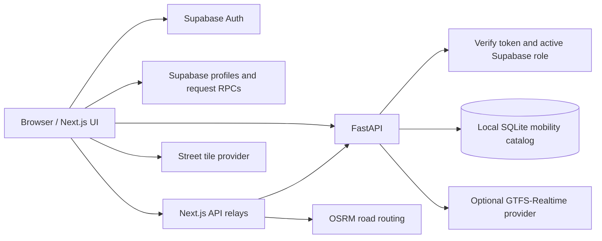

# Architecture

## Product goal

Help viewers understand where a mobility source covers, what its records mean, which patterns can be computed, and what evidence a planning conclusion requires. Data suitability is part of the product: missing coordinates, dates, route shapes or passenger observations must remain visible limitations rather than being replaced with invented values.

## Request flow

Most browser data calls use same-origin Next.js relays. Some existing planner analyses call the configured FastAPI origin directly, so its address must be reachable from browsers and its CORS list must include the frontend origin. Protected operations verify authorization at the backend even when called directly.

## Frontend

- `app/(auth)`: login, signup and planner-access application. `(protected)/layout.tsx` checks the active database profile before rendering dashboard children.
- `lib/access.ts`: role definitions, profile validation, role destinations and review RPC. `lib/server-auth.ts`: per-request bearer verification for privileged Next.js APIs.
- `components/dashboard/PublicFeatureWorkspace.tsx`: shared public map/temporal/insights/travel workspace, server-filtered previews and scrolling coverage search.
- `components/map/InteractiveMap.tsx`: contained MapLibre canvas, data bounds, native geometry, density/point layers and popups. Cluster labels use DOM text so external font availability cannot hide clustered data.
- `lib/map-style.ts`: street basemap defaults and configurable full styles. Basemap data is separate from mobility measurements.
- `components/admin/DatasetImporter.tsx`: preview, column mapping, table selection, source metadata, saved mapping profiles and import reports.
- `components/dashboard/DatasetOverview.tsx` and `ReportsPanel.tsx`: computed suitability/quality summaries and report workflows.
- `app/globals.css` and `tailwind.config.ts`: established colour/gradient/surface system. Avoid blanket global overrides of utility classes.

## Backend ingestion and analysis

1. An authenticated administrator sends a file to preview/import.
2. `tabular_reader.py` and `dataset_readers.py` inspect content; ZIPs are checked for unsafe paths, duplicates and expansion limits.
3. `schema_mapping.py` suggests canonical fields and requires confirmation where mappings are ambiguous. GPS columns are not mandatory for unrelated indicator/tabular data.
4. `gtfs_validation.py` validates table relationships and preserves optional tables. GTFS is stored relationally rather than as unrelated GPS rows.
5. `mobility_store.py` writes the catalog, observations, native geometry, GTFS tables and metadata. Import errors keep the previous active source.
6. An explicit active-source marker selects the dataset used by viewers. SQL aggregates compute temporal/spatial summaries; cached GTFS summaries avoid repeating expensive million-row work.

`CSVDataLoader` remains the compatibility facade name; its responsibilities now include all supported formats, not only CSV. Heavy synchronous work runs in FastAPI workers/thread pools. The catalog uses SQLite and must live on persistent local storage.

## Storage boundaries

| Store | Contains | Ownership/lifetime |
| --- | --- | --- |
| Supabase `auth.users` | Authentication identities | Supabase Auth; never committed |
| Supabase `public.users` | Profile, active flag, application role | Signup trigger and administrator-controlled operations |
| Supabase `planner_requests` | Application and review history | Scoped submit/review functions |
| Supabase `audit_logs` | Request submission/review audit events | Database functions; admin-readable |
| `backend/data/mobility_catalog.sqlite3` | Imported source catalog, observations, GTFS relations, geometries, profiles, reports and caches | Local deployment; back up with source files |
| `backend/data/.active_dataset` | Selected source filename | Global to the running application |

Reports are shared per active dataset among planners/admins. They are not private per-user documents. Supabase's older `datasets`/`analysis_results` tables are not the current mobility-storage implementation.

## Trust and measurement boundaries

Client role checks improve navigation; SQL policies/RPCs and API verification enforce privileged actions. User-editable auth metadata never grants a role. General source data and read-only analysis endpoints currently serve public data; use an additional privacy/authorization design before hosting confidential trajectories.

GTFS counts schedules, point density counts source positions, and nearby-stop accessibility measures straight-line proximity. OSRM estimates a road route; it does not derive live congestion from this project's dataset. Native boundary geometry is retained, but population-weighted or walk-network accessibility and polygon joins are future work.

## Prepared planning layers and briefs (31 October 2026)

The planner workspace now uses an independent GeoPackage with nine Hyderabad layers, queried spatially and projected to EPSG:32644 for measurements. This supplements the globally active mobility source. `app/services/planning.py` owns metric screening and a separate `backend/data/planning/scenarios.sqlite3` stores owner-scoped decision briefs. Both Next.js and FastAPI planning endpoints verify active planner/admin roles. See [PLANNING_WORKSPACE.md](PLANNING_WORKSPACE.md) for method and storage details; do not confuse private planning briefs with the earlier shared mobility reports.
