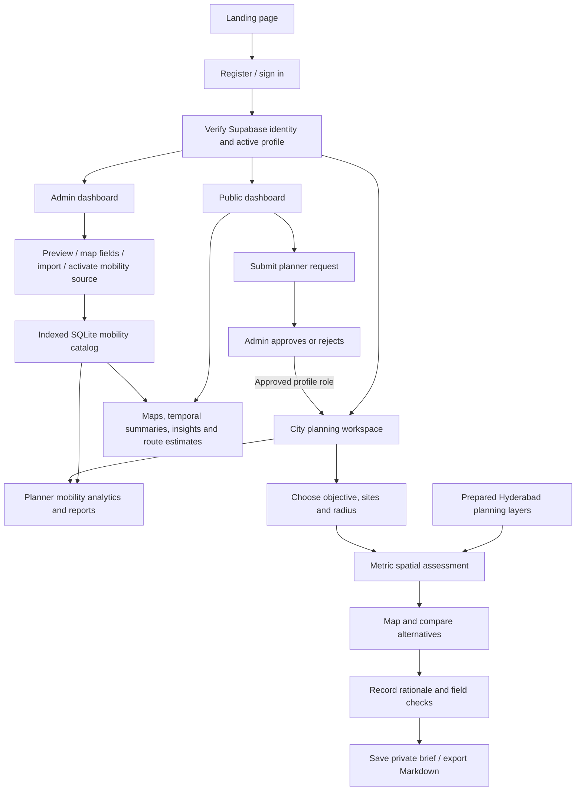
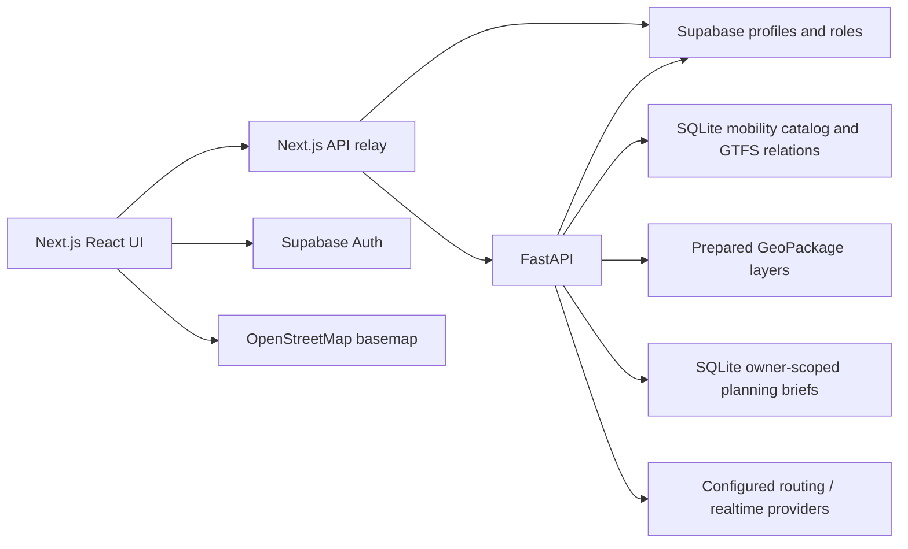

# Project story, workflows and presentation guide

Use this document as source material for a PPT, project report, demonstration script or onboarding session. Statements below describe the implemented application; distinguish future work explicitly.

## Project summary

**Human Mobility Intelligence** combines mobility/transit exploration with urban-planning site screening. It helps users understand the geographic and temporal evidence a dataset actually contains and helps planners compare candidate locations without confusing schedules, mapped infrastructure and observed movement.

The practical problem is fragmented urban evidence: a schedule feed, an amenity map and a population table describe different things. A reliable tool must validate formats and semantics, explain limitations, preserve geographic context and restrict administrative/planning actions to authorised roles.

The current case study is Hyderabad. A historical TGSRTC static feed supports transit exploration. Prepared OpenStreetMap layers support land-use, amenity, road, water and active-mobility screening. Six planner objectives organise the same evidence into relevant review questions. Decisions remain with the planner.

## Application flow

## System architecture

Some existing read-only analytics call FastAPI directly; privileged relays and backend routes independently verify active roles. Public analytical data is intentionally public, so private trajectory data must not be imported without extending data-access controls.

## Data lifecycle

1. **Acquire:** retain original files, source links, dates and licence information.
2. **Inspect:** detect format, preview fields, identify spatial/temporal capabilities, request explicit schema mapping where ambiguous.
3. **Validate:** check coordinates, geometry, relational GTFS integrity and duplicates. Reject unsupported/unsafe archives and report problems.
4. **Store:** normalised mobility data goes into SQLite; separate prepared planning layers go into the spatially indexed GeoPackage.
5. **Analyse:** compute only supported summaries, or run metric site screening over prepared layers.
6. **Explain:** display units, dates, counts, methodology, map-preview limits and missing evidence.
7. **Decide:** planners record rationale and field checks; the system saves/export briefs with source attribution.

## Role responsibilities

| Role | Responsibilities |
| --- | --- |
| Public | Understand source data, explore maps and analyses, request planner access |
| Planner | Compare locations for six planning objectives, examine evidence and gaps, generate reports and decision briefs |
| Admin | Govern access, approve/reject requests, import/configure public datasets, monitor the platform; also use planner tools |

Roles are stored in Supabase and checked at execution time. Selecting a planner entry point is an intent to use a workspace, not permission to elevate an account. Registration defaults to public access. Planner request review is transactional, with audit records and at most one pending request per account.

## Demonstration script

1. Open the landing page; describe the three user responsibilities.
2. Sign in as a public user. Show clustered stop maps, area search and independently scrolling coverage list. Explain why a stop-density heatmap is not demand.
3. Show the planner request workflow and admin review using authorised test accounts.
4. Sign in as an approved planner. Confirm the distinct **City planning workspace** opens.
5. Use the default Abids/Gachibowli alternatives at a 1 km radius. Assess locations and compare nearest stops, mapped uses and facilities.
6. Change the objective to active mobility or policy and recompute. Inspect the maps, explain data gaps and avoid interpreting unmapped sidewalks as absent sidewalks.
7. Add a planning rationale, save the brief and export Markdown. Show how the export retains sources, metrics and limitations.
8. Open mobility analytics/reports to demonstrate the retained GTFS workflow.

Use actual generated results in screenshots and slides. For example, the 31 October preparation produced 25 versus 9 scheduled stop records in the default 1 km study circles, with nearest-stop distances of approximately 93 m and 211 m. These values depend on the pinned feed, candidate coordinates and radius; they are not a claim that one location is universally better.

## Suggested presentation structure

| Slide | Content and evidence |
| --- | --- |
| 1 | Project title, team and Hyderabad case study |
| 2 | Problem: fragmented evidence and misleading interpretation |
| 3 | Objectives: exploration plus six city-planning decision areas |
| 4 | User roles and approval lifecycle |
| 5 | System architecture diagram above |
| 6 | Data sources, nine prepared layers and validation counts |
| 7 | Import/validation/data lifecycle |
| 8 | Public map UX and independent area scrolling |
| 9 | Planner alternatives, spatial methods and comparison screenshot |
| 10 | Decision brief, provenance and reproducibility |
| 11 | Verification results with fixture/live-test distinctions |
| 12 | Limitations, additional evidence and future work |

## Evaluation and honest limits

Use [TESTING.md](TESTING.md), [PROJECT_STATUS.md](PROJECT_STATUS.md) and generated validation evidence for test claims. Spatial tests check clipped metric lengths, nearest distances, union areas and boundary rejection. Permission tests check active roles and account isolation. Browser tests use intercepted authentication; they do not prove an actual user's password works. Live database checks separately verify schema/policies and the authorised account role.

The workbench is not an engineering CAD system, a population-weighted land-use optimiser, a traffic simulation or an official zoning checker. No live demand, journey traces, utility capacity, statutory parcel GIS or flood model is implied. Future research should add authoritative input layers and validated network/optimisation models, then compare results with field observations and domain review.

## Team ownership and next steps

- Frontend: route guards, accessible comparison UI, responsive maps and report presentation.
- Backend: parsers, source semantics, spatial analysis, API authorization and storage.
- Data: provenance, licences, refresh dates, geographic scope and quality audits.
- Planning/domain: evidence interpretation, ground truth, policy constraints and evaluation design.
- Operations: configuration, migration order, persistent storage, backups and controlled deployment.

Read [SETUP.md](SETUP.md) before running, [PLANNING_WORKSPACE.md](PLANNING_WORKSPACE.md) before changing calculations, and [HYDERABAD_DATA_CATALOG.md](HYDERABAD_DATA_CATALOG.md) before importing or interpreting data.
